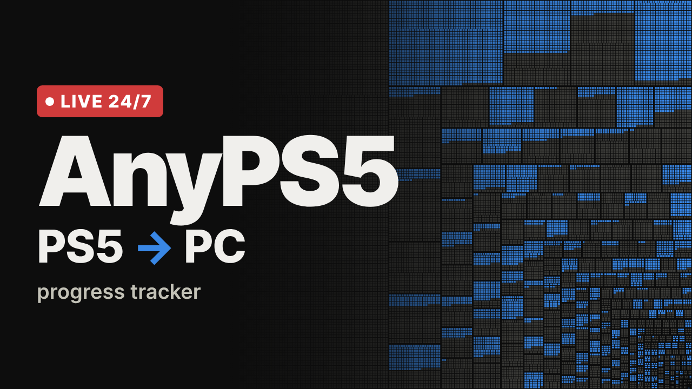

# AnyPS5 Live

A 24/7 YouTube live stream that shows the progress of [AnyPS5](https://github.com/boykopovar/AnyPS5) as a monitoring screen. Everything runs in Docker on a VPS: one container collects the data and serves a 1920×1080 dashboard, the other renders it in a headless browser and streams it to YouTube.



An unofficial community project: it is not affiliated with the AnyPS5 maintainers or with Sony, and it only reads AnyPS5's public data.

## What is on screen

- **Header**: the next milestone (functions to go, estimated from the 7-day pace) and a countdown to the next scene.
- **Rotating scenes**: the dashboard for 45 seconds, then one full-screen scene for 25 seconds, readable on a phone: a game spotlight, the next milestone, top contributors, the biggest gains.
- **Alerts**: a card slides in for each new merged PR, new game report, finished library and new release. Each 1,000th function gets a full-screen celebration.
- **Chat commands**: viewers can ask `!game`, `!lib`, `!next`, `!top`, `!random`, `!discord` or `!help`; answers appear on screen. The first answer can take up to the configured poll interval, and after a command the chat stream stays open for a fast burst. Enable with `CHAT_COMMANDS=1`.
- **Calls to action**: a like, subscribe, Discord or chat reminder every 3 minutes and after each milestone, plus a live like goal when `YOUTUBE_API_KEY` and `YOUTUBE_VIDEO_ID` are set.
- **GTA VI page**: a separate countdown screen with AnyPS5 readiness, Rockstar game reports, the live library map and latest project activity (`PAGE=gta6.html`).

The dashboard scene shows:

- **Key figures**: system functions implemented (with gains over 24 hours and 7 days, and the share of those found so far), PRs merged today and this week, open PRs, games reaching gameplay, GitHub stars and the latest release.
- **System libraries map**: the same squarified treemap as the progress map in AnyPS5's README, redrawn live: one block per library sized by its function count, filled with one cell per function, implemented ones first.
- **Latest merged and opened PRs**: author, age, and the number of functions each PR implemented (green) or declared as stubs (grey), read from the project's progress-report bot. Open PRs show it once the bot has reported.
- **Functions over time**: implemented and declared functions since the project started publishing its history.
- **Major changes**: big daily jumps, milestones, completed libraries, new releases and new libraries, named by what they do where known.
- **Furthest point reported**: the game bring-up threads by the stage their first report reached.
- **Chat answers**: recent on-screen responses at `/api/chat`, read by the browser every two seconds.
- A UTC clock in the corner.

## How it works

```
                 ┌──────────────────────────────┐        ┌──────────────────────────────────┐
 GitHub API ───► │ dashboard (Rust)              │  HTTP  │ streamer                         │  RTMP
 Pages JSON ───► │ collects, detects events,    │ ─────► │ Xvfb + Chromium (kiosk 1920×1080)│ ─────► YouTube
 Discussions ──► │ serves / and /api/state      │        │ GStreamer Rust bindings → H.264 + AAC │
                 │ volume: daily snapshots      │        │ restarts itself on failure       │
                 └──────────────────────────────┘        └──────────────────────────────────┘
```

| Data | Source | Refresh (with token / without) |
|---|---|---|
| Progress, history, libraries, PRs/reports, stars, releases and merge counts | AnyPS5 Pages JSON and GitHub REST/search APIs | 5 / 10 min |
| Game stages and covers | AnyPS5's [Game bring-up discussions](https://github.com/boykopovar/AnyPS5/discussions/categories/game-bring-up), GitHub GraphQL API, and the archived roadmap image JSON | 10 min / not available |
| Live likes and viewers | YouTube Data API v3 (when `YOUTUBE_API_KEY` and `YOUTUBE_VIDEO_ID` are set) | 1 min |
| Live chat commands and reminders | YouTube live chat streaming API (commands require `CHAT_COMMANDS=1`; reminders also require YouTube OAuth) | configurable |

The dashboard keeps one snapshot of every library per day in the `dashboard-data` volume. Comparing snapshots is what finds new libraries, newly discovered exports and completed libraries as they happen. History-based events (export waves, big jumps, milestones) are there from the first minute.

A game's stage is the "Furthest point" of the first report in its thread, read from the discussion's form. Later replies are not read, so the counts can lag behind, and a thread whose first report gives no recognisable stage counts as reported but in no stage. "In game" means gameplay was reached, not that the game is playable from start to finish.

The browser page refreshes its data every 15 seconds and reloads itself every 6 hours; Chromium is restarted every 24 hours to keep memory flat.

## Requirements

- A VPS with Docker Engine and the Compose plugin.
- About 4 vCPU (5 during scene changes) and 2 GB of RAM for the default 1440p at 30 fps (`PRESET=superfast`).
- Outbound TCP 1935 (RTMP) and about 13 Mbit/s of upload.

## Set up

1. **YouTube**: in YouTube Studio, choose *Create → Go live → Stream*. Copy the stream key. For a 24/7 stream, turn on *Auto-start*, turn off *Auto-stop*, keep latency on *Normal* and enable DVR. A channel that has never streamed may need to be verified and wait up to 24 hours before live streaming is enabled.
2. **GitHub token** (optional, recommended): create a fine-grained token at <https://github.com/settings/personal-access-tokens/new> with *Public repositories (read-only)* access and no permissions. Without it the dashboard still works, but stays within 60 API requests per hour and shows no game data, since GitHub's GraphQL API requires a token.
3. **Deploy**:

   ```bash
   git clone <this repository> anyps5-live && cd anyps5-live
   cp .env.example .env
   nano .env            # YOUTUBE_STREAM_KEY, GITHUB_TOKEN
   docker compose up -d --build
   docker compose logs -f streamer
   ```

   The streamer waits for the dashboard's health check, starts the browser, then begins streaming. YouTube shows the preview within a minute.

### Single container

Some platforms build one Dockerfile and run one service (Coolify, Dokku, a self-hosted hub that deploys a GitHub repository on every push). For those, the `Dockerfile` at the root of the repository builds an image that runs the dashboard and the streamer together:

- Dockerfile: `Dockerfile`, build context: the repository root.
- Environment: `YOUTUBE_STREAM_KEY`, and optionally `GITHUB_TOKEN` and the encoder settings below. Without a stream key, the container only serves the dashboard.
- Port: the dashboard listens on `3000` (change it with `PORT`). Expose it only if you want to see the screen in a browser; the stream does not need it.
- Persistent data: mount a volume on `/data` to keep the daily snapshots across redeploys.

```bash
docker build -t anyps5-live .
docker run -d --restart unless-stopped -e YOUTUBE_STREAM_KEY=... -v anyps5-data:/data anyps5-live
```

## Preview and test without going live

- **See the dashboard** from your computer through an SSH tunnel:

  ```bash
  ssh -L 8080:127.0.0.1:8080 user@your-vps
  ```

  Then open <http://localhost:8080> in a window sized 1920×1080.

- **See one scene or alert**: add `?scene=games` (or `contributors`, `movers`, `milestone`) to pin a scene, or `?demo=alert` / `?demo=milestone` / `?demo=chat` to play an alert.
- **Preview the GTA VI screen**: open `http://localhost:8080/gta6.html` or stream it with `PAGE=gta6.html`.

- **Record 30 seconds to a file** instead of streaming:

  ```bash
  docker compose run --rm -e OUTPUT=/recordings/test.mp4 -e RECORD_SECONDS=30 streamer
  ```

  The file appears in `./recordings/test.mp4`.

## Operate

| Task | Command |
|---|---|
| Logs | `docker compose logs -f dashboard streamer` |
| Update after a change | `git pull && docker compose up -d --build` |
| Restart the stream only | `docker compose restart streamer` |
| Stop everything | `docker compose down` (the snapshots stay in the volume) |
| Current state as JSON | `curl -s http://127.0.0.1:8080/api/state` |

**Soundtrack**: put `.mp3`, `.m4a`, `.ogg`, `.flac`, or `.wav` tracks in `./music`. The Rust GStreamer pipeline shuffles the playlist and applies EBU R128 loudness normalization (`-22 LUFS`, `-2 dBTP`, `11 LU`) to music. Shorts select one available track and fade it in and out. With no files, the stream uses silence.

## Rust rebuild benchmarks

The same-host comparison against the original fork measures image size, startup, API latency, memory and a finite encode job. Results and the reproducible PowerShell benchmark are in [BENCHMARKS.md](BENCHMARKS.md).

## Daily Short

Every day from `SHORT_HOUR_UTC`, the streamer records a 30-second vertical video into `/recordings/shorts` (the last 14 days are kept) on a second virtual display, without touching the stream. It introduces the project for viewers who have never heard of it, shows well-known games reaching gameplay, then the day's progress. `docker compose exec streamer shorts.sh once` makes today's right away.

To upload it automatically:

1. In a Google Cloud project, enable the *YouTube Data API v3* and create an OAuth client of type *Desktop app*. Set the consent screen's publishing status to **In production**: in *Testing*, the refresh token stops working after 7 days.
2. Run `cargo run --manifest-path tools/Cargo.toml -- <client id> <client secret>` on a computer with a browser, and sign in as the channel's owner.
3. Set `YOUTUBE_CLIENT_ID`, `YOUTUBE_CLIENT_SECRET` and `YOUTUBE_REFRESH_TOKEN`, then restart.

The logs give each Short's URL and privacy. YouTube can lock uploads from an unaudited API project as private: if they come back `private` while `SHORT_PRIVACY` is `public`, the project needs YouTube's [API audit](https://support.google.com/youtube/contact/yt_api_form).

## Thumbnail

`thumbnail.png` (1280×720) is ready to upload as the stream's thumbnail. To regenerate it with the current library map while the dashboard runs:

```bash
docker compose run --rm --entrypoint chromium streamer --headless=new --no-sandbox --disable-gpu   --hide-scrollbars --window-size=1280,720 --virtual-time-budget=20000   --screenshot=/recordings/thumbnail.png http://dashboard:8080/thumbnail.html
```

## Configuration

| Variable | Default | Purpose |
|---|---|---|
| `YOUTUBE_STREAM_KEY` | | YouTube stream key |
| `YOUTUBE_RTMP_URL` | `rtmp://a.rtmp.youtube.com/live2` | Ingest server (use `rtmp://b.rtmp.youtube.com/live2?backup=1` as a backup) |
| `OUTPUT` | | Overrides the destination: another RTMP URL or a file path |
| `RECORD_SECONDS` | | Stop after this many seconds (for tests) |
| `GITHUB_TOKEN` | | Read-only GitHub token |
| `WIDTH` / `HEIGHT` | `2560` / `1440` | Output resolution. The 1920×1080 page is rendered at this size rather than scaled up, so it stays sharp |
| `FPS` / `CAPTURE_FPS` | `30` / `30` | Output and capture frame rates. YouTube needs a steady 30 fps at a constant bitrate. A lower capture rate repeats frames, which saves some CPU but makes the animations stutter |
| `VIDEO_BITRATE` / `BUFSIZE` / `PRESET` | `12000k` / `24000k` / `superfast` | Encoder settings, constant bitrate |
| `WARMUP_SECONDS` | `15` | Browser render warm-up before video capture |
| `YOUTUBE_API_KEY` / `YOUTUBE_VIDEO_ID` | | Reads the live's likes each minute for the like goal |
| `CHAT_COMMANDS` | `0` | Enables on-screen `!game`, `!lib`, `!next`, `!top`, `!random`, `!discord` and `!help` answers. Needs the YouTube API key and video ID |
| `CHAT_POLL_SECONDS` / `CHAT_BURST_MINUTES` / `CHAT_DAILY_UNITS` | `75` / `3` / `8000` | Opens a YouTube chat stream on this idle interval; after a command it reconnects within seconds for the burst window, capped by daily API units |
| `CHAT_REMINDER_MINUTES` | `60` | Posts command reminders in chat. Set to `0` to turn off; needs YouTube OAuth values with the `youtube.force-ssl` scope |
| `SHORTS` / `SHORT_HOUR_UTC` / `SHORT_PRIVACY` | `1` / `18` / `public` | The daily Short: on or off, the hour it is made, and its privacy on YouTube |
| `YOUTUBE_CLIENT_ID` / `YOUTUBE_CLIENT_SECRET` / `YOUTUBE_REFRESH_TOKEN` | | Uploads the daily Short |
| `PORT` | `8080` (`3000` in the single-container image) | Dashboard port |
| `ANYPS5_REPO` | `boykopovar/AnyPS5` | Repository to follow (dashboard) |
| `ANYPS5_PAGES` | `https://boykopovar.github.io/AnyPS5` | Where `progress.json` and `history.json` are published |
| `ROADMAP_URL` | `https://alxcbtw.github.io/anyps5-roadmap` | Where the game cover images come from |
| `PAGE` | | Opens a dashboard page other than the main screen, for example `gta6.html` |

## Troubleshooting

- **YouTube says "No data"**: check the stream key, that outbound port 1935 is open, and `docker compose logs streamer` for GStreamer errors.
- **Black or frozen picture**: `docker compose exec streamer cat /tmp/chromium.log`. The compose file gives the streamer 1 GB of shared memory, which Chromium needs.
- **Blurry on YouTube**: YouTube re-encodes every stream. From a 1080p input it serves low-bitrate H.264, which smears the library map's thousands of cells; from 1440p it serves sharper VP9 encodes at every quality, 1080p included. Keep the default 1440p, and keep the stream latency on *Normal*.
- **High CPU**: the encoder works on every output frame, repeated or not. Use `PRESET=ultrafast`, or stream 1080p (`WIDTH=1920 HEIGHT=1080 VIDEO_BITRATE=6000k`).
- **YouTube: "not receiving enough video"**: keep `FPS=30` and the constant bitrate; YouTube's ingest does not accept a very low frame rate or a mostly empty bitrate.
- **Panels show "—"**: a source is slow or rate-limited. `curl -s http://127.0.0.1:8080/api/state` lists every source with its last success and error under `sources`. Add a `GITHUB_TOKEN`, or wait for the next refresh; the last good data stays on screen.

## Develop locally

```bash
cd dashboard
cargo run            # http://localhost:8080, data kept in dashboard/data
```

## License

[MIT](LICENSE)
