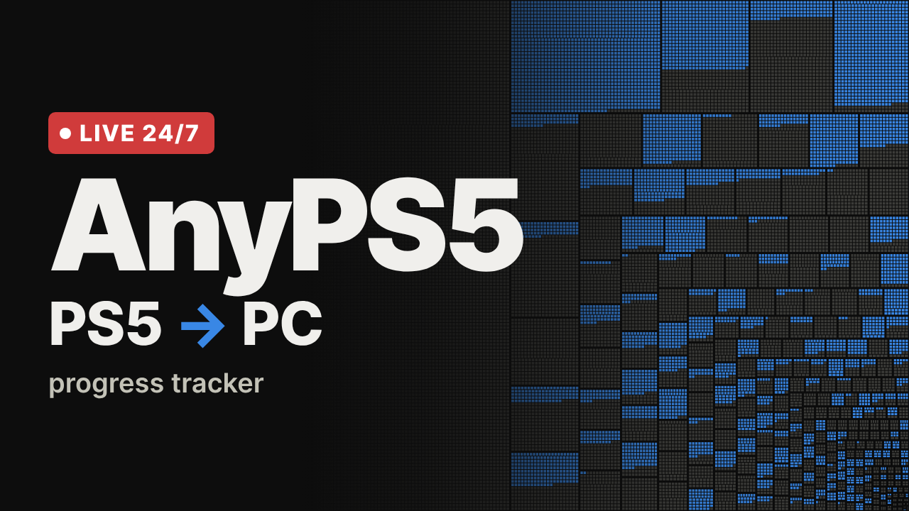

# AnyPS5 Live

24/7 YouTube live monitor of AnyPS5 progress: a Rust dashboard and a headless Chromium and ffmpeg streamer, in Docker.



## What it is

A 24/7 YouTube live stream that shows the progress of [AnyPS5](https://github.com/boykopovar/AnyPS5) as a monitoring screen. Everything runs in Docker on a VPS: one container collects the data and serves a 1920×1080 dashboard, the other renders it in a headless browser and streams it to YouTube. It also records a daily vertical Short and can upload it to YouTube.

An unofficial community project: it is not affiliated with the AnyPS5 maintainers or with Sony, and it only reads AnyPS5's public data.

## Features

### On screen

- **Header**: GTA VI's status on AnyPS5 (not dumped yet, the firmware it needs and the highest public jailbreak) and a countdown to the next scene.
- **GTA VI scene**: every other scene, for 40 seconds: where GTA VI stands on AnyPS5 (out on PS5, dumped, playable on PC), the PS5 firmware it needs against the highest public jailbreak, the time since its release and the Rockstar games already on AnyPS5. Its status is set in one place, `dashboard/src/gta6.rs`, which also feeds the GTA VI page and `!gta`.
- **Rotating scenes**: the dashboard for 45 seconds, then a full-screen scene, readable on a phone: GTA VI, the next milestone, top contributors, the biggest gains. The game spotlight is out of the rotation while GTA VI is new; `?scene=games` still shows it.
- **Alerts**: a card slides in for each new merged PR, new game report, finished library and new release. Each 1,000th function gets a full-screen celebration.
- **Chat commands**: viewers type `!gta` for GTA VI's status, `!game <name>` to see how far a game got (short names like `gta v` work), `!lib <name>` for a system library, `!next` for the next goal, `!top` for the day's top contributor, `!random` for a game reaching gameplay, `!discord` for a code to join the Discord, or `!help`. The answer slides in on screen with their name: within about 75 seconds for the first command, then within seconds for the next 3 minutes. What viewers type is never shown. Set `CHAT_COMMANDS=1` to turn them on. Every `CHAT_REMINDER_MINUTES`, the channel posts a reminder of the commands in the chat, when the OAuth values are set.
- **Calls to action**: a like, subscribe, Discord or chat command card every 3 minutes and after each milestone, and a live like goal beside the title once `YOUTUBE_API_KEY` and `YOUTUBE_VIDEO_ID` are set.

### Dashboard scene

The dashboard scene shows:

- **Key figures**: system functions implemented (with gains over 24 hours and 7 days, and the share of those found so far), PRs merged today and this week, open PRs, games reaching gameplay, GitHub stars and the latest release.
- **System libraries map**: the same squarified treemap as the progress map in AnyPS5's README, redrawn live: one block per library sized by its function count, filled with one cell per function, implemented ones first.
- **Latest merged and opened PRs**: author, age, and the number of functions each PR implemented (green) or declared as stubs (grey), read from the project's progress-report bot. Open PRs show it once the bot has reported.
- **Functions over time**: implemented and declared functions since the project started publishing its history.
- **Major changes**: big daily jumps, milestones, completed libraries, new releases and new libraries, named by what they do where known.
- **Furthest point reported**: the game bring-up threads by the stage their first report reached.
- A UTC clock in the corner.

## Getting started

### Prerequisites

- A VPS with Docker Engine and the Compose plugin.
- About 4 vCPU (5 during scene changes) and 2 GB of RAM for the default 1440p at 30 fps (`PRESET=superfast`).
- Outbound TCP 1935 (RTMP) and about 13 Mbit/s of upload.

### Configure

1. **YouTube**: in YouTube Studio, choose *Create → Go live → Stream*. Copy the stream key. For a 24/7 stream, turn on *Auto-start*, turn off *Auto-stop*, keep latency on *Normal* and enable DVR. A channel that has never streamed may need to be verified and wait up to 24 hours before live streaming is enabled.
2. **GitHub token** (optional, recommended): create a fine-grained token at <https://github.com/settings/personal-access-tokens/new> with *Public repositories (read-only)* access and no permissions. Without it the dashboard still works, but stays within 60 API requests per hour and shows no game data, since GitHub's GraphQL API requires a token.

Then fill in `.env` (copied from `.env.example`); the variables are described in the [configuration reference](#configuration-reference).

### Run

```bash
git clone <this repository> anyps5-live && cd anyps5-live
cp .env.example .env
nano .env            # YOUTUBE_STREAM_KEY, GITHUB_TOKEN
docker compose up -d --build
docker compose logs -f streamer
```

The streamer waits for the dashboard's health check, starts the browser, then begins streaming. YouTube shows the preview within a minute.

### Run in a single container

Some platforms build one Dockerfile and run one service (Coolify, Dokku, a self-hosted hub that deploys a GitHub repository on every push). For those, the `Dockerfile` at the root of the repository builds an image that runs the dashboard and the streamer together:

- Dockerfile: `Dockerfile`, build context: the repository root.
- Environment: `YOUTUBE_STREAM_KEY`, and optionally `GITHUB_TOKEN` and the encoder settings from the [configuration reference](#configuration-reference). Without a stream key, the container only serves the dashboard.
- Port: the dashboard listens on `3000` (change it with `PORT`). Expose it only if you want to see the screen in a browser; the stream does not need it.
- Persistent data: mount a volume on `/data` to keep the daily snapshots across redeploys.

```bash
docker build -t anyps5-live .
docker run -d --restart unless-stopped -e YOUTUBE_STREAM_KEY=... -v anyps5-data:/data anyps5-live
```

### Preview and test without going live

- **See the dashboard** from your computer through an SSH tunnel:

  ```bash
  ssh -L 8080:127.0.0.1:8080 user@your-vps
  ```

  Then open <http://localhost:8080> in a window sized 1920×1080.

- **See one scene or alert**: add `?scene=gta6` (or `games`, `contributors`, `movers`, `milestone`) to pin a scene, or `?demo=alert` / `?demo=milestone` / `?demo=chat` to play an alert.

- **Record 30 seconds to a file** instead of streaming:

  ```bash
  docker compose run --rm -e OUTPUT=/recordings/test.mp4 -e RECORD_SECONDS=30 streamer
  ```

  The file appears in `./recordings/test.mp4`.

## How it works

```
                 ┌──────────────────────────────┐        ┌──────────────────────────────────┐
 GitHub API ───► │ dashboard (Rust/Axum)        │  HTTP  │ streamer                         │  RTMP
 Pages JSON ───► │ collects, detects events,    │ ─────► │ Xvfb + Chromium (kiosk 1920×1080)│ ─────► YouTube
 Discussions ──► │ serves / and /api/state      │        │ ffmpeg x11grab → H.264 + AAC     │
                 │ volume: daily snapshots      │        │ restarts itself on failure       │
                 └──────────────────────────────┘        └──────────────────────────────────┘
```

| Data | Source | Refresh (with token / without) |
|---|---|---|
| Progress, per-library counts | `https://boykopovar.github.io/AnyPS5/progress.json` | 10 / 15 min |
| History | `https://boykopovar.github.io/AnyPS5/history.json` | 30 min |
| Merged PRs and their progress reports | GitHub REST API | 2 / 6 min |
| Open PRs, merges per period | GitHub search API | 5 / 10 min |
| Stars, latest release | GitHub REST API | 10 / 30 min |
| Games by stage | AnyPS5's [Game bring-up discussions](https://github.com/boykopovar/AnyPS5/discussions/categories/game-bring-up), GitHub GraphQL API | 10 min / not available |
| Game covers | `https://alxcbtw.github.io/anyps5-roadmap/roadmap.json` (archived on 24 October 2026; only its images are used) | 3 h |

The dashboard keeps one snapshot of every library per day in the `dashboard-data` volume. Comparing snapshots is what finds new libraries, newly discovered exports and completed libraries as they happen. History-based events (export waves, big jumps, milestones) are there from the first minute.

A game's stage is the "Furthest point" of the first report in its thread, read from the discussion's form. Later replies are not read, so the counts can lag behind, and a thread whose first report gives no recognisable stage counts as reported but in no stage. "In game" means gameplay was reached, not that the game is playable from start to finish.

The browser page refreshes its data every 15 seconds and reloads itself every 6 hours; Chromium is restarted every 24 hours to keep memory flat.

## Operate

| Task | Command |
|---|---|
| Logs | `docker compose logs -f dashboard streamer` |
| Update after a change | `git pull && docker compose up -d --build` |
| Restart the stream only | `docker compose restart streamer` |
| Stop everything | `docker compose down` (the snapshots stay in the volume) |
| Current state as JSON | `curl -s http://127.0.0.1:8080/api/state` |

**Soundtrack**: YouTube requires an audio track, so the streamer sends silence by default. Put `.mp3`, `.m4a`, `.ogg`, `.flac` or `.wav` files in `./music` to play them in shuffled order instead, then restart the streamer; their loudness is evened out. Use only music you have the rights to stream. In single-container mode, mount the folder on `/music`.

## Daily Short

Every day from `SHORT_HOUR_UTC`, the streamer records a 30-second vertical video into `/recordings/shorts` (the last 14 days are kept) on a second virtual display, without touching the stream. It introduces the project for viewers who have never heard of it, shows well-known games reaching gameplay, then the day's progress. `docker compose exec streamer shorts.sh once` makes today's right away.

To upload it automatically:

1. In a Google Cloud project, enable the *YouTube Data API v3* and create an OAuth client of type *Desktop app*. Set the consent screen's publishing status to **In production**: in *Testing*, the refresh token stops working after 7 days.
2. Run `node tools/youtube-auth.mjs <client id> <client secret>` on a computer with a browser, and sign in as the channel's owner.
3. Set `YOUTUBE_CLIENT_ID`, `YOUTUBE_CLIENT_SECRET` and `YOUTUBE_REFRESH_TOKEN`, then restart.

The logs give each Short's URL and privacy. YouTube can lock uploads from an unaudited API project as private: if they come back `private` while `SHORT_PRIVACY` is `public`, the project needs YouTube's [API audit](https://support.google.com/youtube/contact/yt_api_form).

## Thumbnail

`thumbnail.png` (1280×720) is ready to upload as the stream's thumbnail. To regenerate it with the current library map while the dashboard runs:

```bash
docker compose run --rm --entrypoint chromium streamer --headless=new --no-sandbox --disable-gpu   --hide-scrollbars --window-size=1280,720 --virtual-time-budget=20000   --screenshot=/recordings/thumbnail.png http://dashboard:8080/thumbnail.html
```

## Configuration reference

All variables go in `.env` (see `.env.example`).


| Variable | Default | Purpose |
|---|---|---|
| `YOUTUBE_STREAM_KEY` | | YouTube stream key |
| `YOUTUBE_RTMP_URL` | `rtmp://a.rtmp.youtube.com/live2` | Ingest server (use `rtmp://b.rtmp.youtube.com/live2?backup=1` as a backup) |
| `OUTPUT` | | Overrides the destination: another RTMP URL or a file path |
| `RECORD_SECONDS` | | Stop after this many seconds (for tests) |
| `GITHUB_TOKEN` | | Read-only GitHub token |
| `WIDTH` / `HEIGHT` | `2560` / `1440` | Output resolution. The 1920×1080 page is rendered at this size rather than scaled up, so it stays sharp |
| `FPS` / `CAPTURE_FPS` | `30` / `30` | Output and capture frame rates. YouTube needs a steady 30 fps at a constant bitrate. A lower capture rate repeats frames, which saves some CPU but makes the animations stutter |
| `VIDEO_BITRATE` / `BUFSIZE` / `PRESET` | `12000k` / `24000k` / `superfast` | Encoder settings, constant bitrate |
| `YOUTUBE_API_KEY` / `YOUTUBE_VIDEO_ID` | | Reads the live's likes every 2 minutes for the like goal |
| `CHAT_COMMANDS` / `CHAT_POLL_SECONDS` / `CHAT_BURST_MINUTES` / `CHAT_DAILY_UNITS` | `0` / `75` / `3` / `8000` | Answers the chat commands on screen. YouTube closes a quiet chat stream after about 10 seconds and each opening costs 5 of the key's 10,000 daily units, so the stream opens every `CHAT_POLL_SECONDS`, and stays open for `CHAT_BURST_MINUTES` after a command, within `CHAT_DAILY_UNITS` a day. Needs the API key and video ID |
| `CHAT_REMINDER_MINUTES` | `60` | Posts a reminder of the commands in the chat as the channel, 50 API units each. `0` turns it off. Needs the OAuth values with the `youtube.force-ssl` scope |
| `SHORTS` / `SHORT_HOUR_UTC` / `SHORT_PRIVACY` | `1` / `18` / `public` | The daily Short: on or off, the hour it is made, and its privacy on YouTube |
| `YOUTUBE_CLIENT_ID` / `YOUTUBE_CLIENT_SECRET` / `YOUTUBE_REFRESH_TOKEN` | | Uploads the daily Short |
| `PAGE` | | Streams another page of the dashboard, such as `gta6.html`, instead of the main screen. It needs its own YouTube stream key |
| `PORT` | `8080` (`3000` in the single-container image) | Dashboard port |
| `ANYPS5_REPO` | `boykopovar/AnyPS5` | Repository to follow (dashboard) |
| `ANYPS5_PAGES` | `https://boykopovar.github.io/AnyPS5` | Where `progress.json` and `history.json` are published |
| `ROADMAP_URL` | `https://alxcbtw.github.io/anyps5-roadmap` | Where the game cover images come from |

## Troubleshooting

- **YouTube says "No data"**: check the stream key, that outbound port 1935 is open, and `docker compose logs streamer` for ffmpeg errors.
- **Black or frozen picture**: `docker compose exec streamer cat /tmp/chromium.log`. The compose file gives the streamer 1 GB of shared memory, which Chromium needs.
- **Blurry on YouTube**: YouTube re-encodes every stream. From a 1080p input it serves low-bitrate H.264, which smears the library map's thousands of cells; from 1440p it serves sharper VP9 encodes at every quality, 1080p included. Keep the default 1440p, and keep the stream latency on *Normal*.
- **High CPU**: the encoder works on every output frame, repeated or not. Use `PRESET=ultrafast`, or stream 1080p (`WIDTH=1920 HEIGHT=1080 VIDEO_BITRATE=6000k`).
- **YouTube: "not receiving enough video"**: keep `FPS=30` and the constant bitrate; YouTube's ingest does not accept a very low frame rate or a mostly empty bitrate.
- **Panels show a dash instead of a value**: a source is slow or rate-limited. `curl -s http://127.0.0.1:8080/api/state` lists every source with its last success and error under `sources`. Add a `GITHUB_TOKEN`, or wait for the next refresh; the last good data stays on screen.

## Development

```bash
cd dashboard
cargo test --locked
cargo run --locked   # http://localhost:8080, data kept in dashboard/data
```

The [Rust dashboard workflow](.github/workflows/rust-dashboard.yml) checks the locked dependencies, tests and formatting, builds the dashboard image and the single-container image, and smoke-tests the dashboard API and static pages.

## Tech stack

- Rust dashboard: Axum, tokio, reqwest (rustls), tonic and prost (YouTube live chat over gRPC), chrono
- Plain HTML, CSS and JavaScript pages in `dashboard/public`
- Streamer: Xvfb, Chromium in kiosk mode and ffmpeg (x11grab, H.264 and AAC over RTMP) on Debian bookworm
- Docker and Docker Compose; a Node.js helper (`tools/youtube-auth.mjs`) for the YouTube OAuth refresh token

## License

[MIT](LICENSE)
